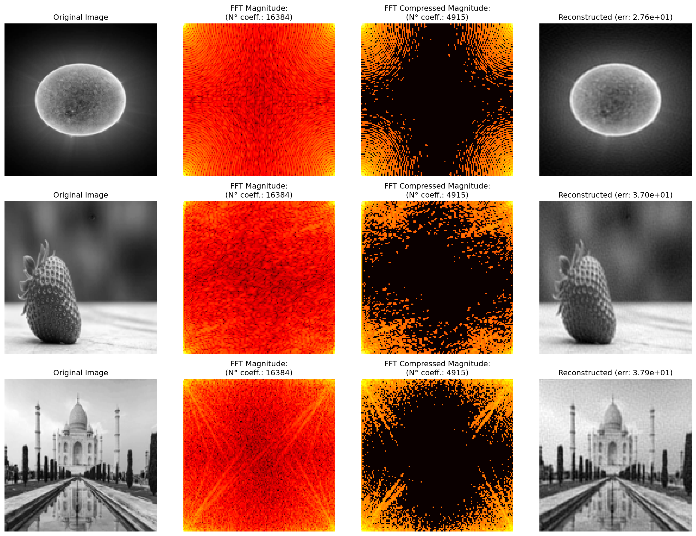
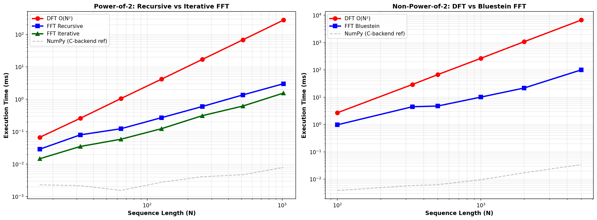

This repository implements generalized multidimensional **Fast Fourier Transform (FFT)** and **Inverse Fast Fourier Transform (IFFT)** algorithms in Python.

## Characteristics
The repository provides a unified API:
* X[F] = core.fft( x[n] )
* x[n] = core.ifft( X[F] )

The algorithms automatically handle multidimensional inputs and select an appropriate implementation based on the input dimensions. For sequences whose length is a power of two, the FFT uses an iterative radix-2 Cooley–Tukey algorithm. For sequences of arbitrary length, it uses Bluestein's algorithm.

## Example
One interesting application of the Fourier transform is **lossy data compression**.

In the example by retaining only the 30% of Fourier coefficients with the largest magnitudes, the frequency-domain representation can be made significantly sparser while preserving the main visual features of the example images, achieving overall a 70% data reduction.

This is a simple demonstration of the trade-off between representation sparsity and reconstruction quality: discarding coefficients reduces the amount of frequency-domain information retained, but also introduces reconstruction error.

  

## Benchmark
I have also included a small benchmark comparing the FFT with the direct DFT. Note that the comparison with NumPy's implementation is not entirely fair, as NumPy uses an optimized C backend.

  

## Algorithm References

- Cooley, J. W., & Tukey, J. W. (1965). 
  [An Algorithm for the Machine Calculation of Complex Fourier Series](https://doi.org/10.1090/S0025-5718-1965-0178586-1).
  *Mathematics of Computation, 19*(90), 297–301.

- Bluestein, L. I. (1970).
  [A Linear Filtering Approach to the Computation of Discrete Fourier Transform](https://doi.org/10.1109/TAU.1970.1162132).
  *IEEE Transactions on Audio and Electroacoustics, 18*(4), 451–455.